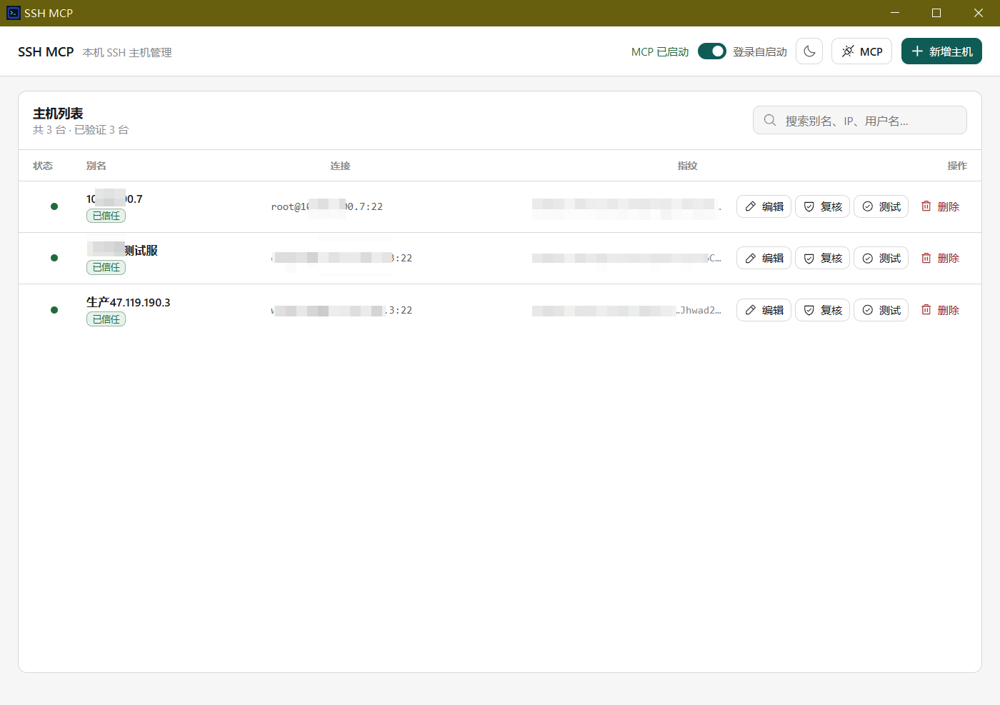
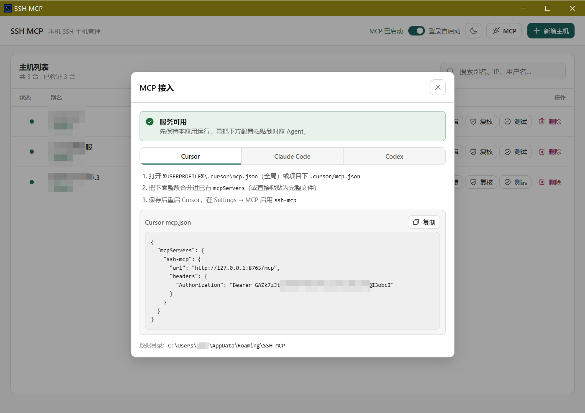

# shell4AI

在 Windows 本机托管 SSH，让 Cursor / Claude Code / Codex 等 AI Agent **只凭主机别名或 IP 执行命令**，密码留在你自己的电脑里，不会进对话、也不会交给 Agent。

## 界面预览

主机列表：



MCP 接入（可一键复制 Cursor / Claude Code / Codex 配置）：



## 快速开始

### 1. 启动应用

任选一种方式：

- **便携版**：解压后双击 `shell4AI.exe`
- **安装包**：运行 `shell4AI_0.1.0_x64-setup.exe` 安装后启动
- **从源码运行**（需本机开发环境）：见文末「开发与构建」

启动后会出现托盘图标。关闭窗口只会隐藏到托盘；要停止服务请用托盘菜单「退出」。

### 2. 添加并验证主机

1. 点击「新增主机」，填写别名、IP/主机名、端口、用户名、SSH 密码。
2. 点击「验证」核对服务器指纹，确认后信任。
3. 可选：点「测试」确认能连上。

密码只保存在本机（加密存储）。Agent 侧永远看不到密码。

### 3. 把 MCP 接到你的 AI 工具

1. 保持 shell4AI **正在运行**。
2. 点击顶栏 **MCP**。
3. 选择 **Cursor / Claude Code / Codex** 标签，复制配置。
4. 粘贴到对应工具的配置文件并按界面提示重启 / 启用。

之后在对话里让 AI 使用已登记的别名或 IP 即可，例如：「在 `测试服` 上执行 `hostname`」。

### 4. 日常使用提示

- 需要时打开窗口管理主机；不用时关窗即可，MCP 仍在托盘后台运行。
- 可在顶栏开关「登录自启动」。
- 支持亮色 / 暗色主题切换。

## 它能做什么

- 用图形界面管理多台 SSH 主机（增删改、测连通、验证指纹）
- 本机常驻 MCP 服务，供各类 Agent 调用
- Agent 只能操作你已登记且已信任的主机；不能传入密码
- 关闭窗口进托盘，退出才停止服务；支持登录自启动、单实例

MCP 提供的工具：

| 工具 | 作用 |
|---|---|
| `list_hosts` | 列出已登记主机（不含凭据） |
| `ssh_exec` | 在指定主机执行命令 |
| `ssh_read_file` | 读取远程文本文件 |
| `ssh_list_dir` | 列出远程目录 |

## 安全说明（给使用者）

- 密码加密保存在本机用户目录，不会通过 MCP 返回给 Agent。
- MCP 默认只监听 `127.0.0.1`，不要直接暴露到公网。
- 未确认 SSH 指纹前，不会真正登录执行命令。
- 当前版本支持密码登录；数据目录默认在 `%APPDATA%\SSH-MCP`。

---

## 开发与构建

以下内容面向想改代码或自行打包的开发者。

### 环境

- Windows 10/11
- Node.js 20+
- Rust stable + MSVC 工具链
- WebView2 Runtime（Windows 11 通常已内置）

Cargo 默认路径：`%USERPROFILE%\.cargo\bin`。国内网络建议自备 crates 镜像（如 rsproxy sparse）。

### 开发

```powershell
.\scripts\setup.ps1
.\scripts\run-dev.ps1
```

或分步：

```powershell
$env:PATH = "$env:USERPROFILE\.cargo\bin;$env:PATH"
npm install
cd src-tauri
cargo test --all-targets
cd ..
npm run build
npm run tauri -- dev
```

检查：

```powershell
.\scripts\check.ps1
```

### 打包

```powershell
.\scripts\build-standalone.ps1
.\scripts\build-portable.ps1
.\scripts\smoke-portable.ps1
```

常见输出：

```text
src-tauri\target\bundle-release\shell4AI.exe
src-tauri\target\bundle-release\bundle\nsis\shell4AI_0.1.0_x64-setup.exe
dist\shell4AI-portable\shell4AI.exe
dist\shell4AI_0.1.0_x64-portable.zip
```

### 数据目录与实现要点

默认目录：`%APPDATA%\SSH-MCP`（可用环境变量 `SSH_MCP_DATA_DIR` 覆盖）

| 文件 | 说明 |
|---|---|
| `store.json` | 主机元数据与密码密文 |
| `settings.json` | MCP 地址与加密 Token |
| `master.key.dpapi` | DPAPI 保护的 AES 主密钥 |
| `audit.jsonl` | 审计 |
| `logs\shell4AI.log` | 运行日志 |

技术栈摘要：Rust + Tauri 2、React GUI、`russh` SSH/SFTP、本机 Streamable HTTP MCP、AES-256-GCM + Windows DPAPI、主机指纹强制校验。

项目结构：

```text
src/                 React GUI
src-tauri/src/       Rust 后端（MCP / SSH / 加密 / 托盘 / 自启动）
scripts/             开发、检查、打包脚本
image/               README 截图
```
